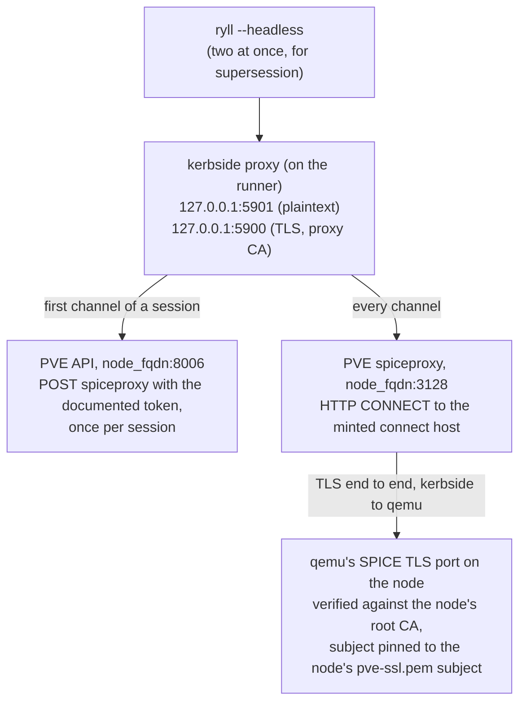

# proxmox-e2e: Proxmox VE end-to-end kerbside lane

This directory holds the runner-side scripts for the Proxmox lane, which
proves the `type: proxmox` source driver (`kerbside/sources/proxmox.py`)
against a real Proxmox VE node. `shakenfist/actions`'
`deploy-proxmox-on-shakenfist` action builds the node. Kerbside runs on
the CI runner, off-box from PVE, and relays a real SPICE session through
its Rust proxy and PVE's `spiceproxy`. The direct-qemu lane's tunnel
checks prove the same backend leg against `connect-proxy.py`, which
behaves like `spiceproxy`. This lane is the only place it meets the real
thing.

## Topology

- The PVE node is a single PVE 9 instance in the runner's Shaken Fist
  namespace, at the action's `node_address` (`10.0.2.2` by default) and
  `node_fqdn`, which the action maps in the runner's `/etc/hosts`. It runs
  the action's SPICE smoke guest (vmid 100, `qxl`), and the guests
  `prepare-node.sh` adds for discovery to skip.
- kerbside (REST API on `13002`, SPICE proxy on `5900`/`5901`, MariaDB)
  runs on the CI runner as plain processes, via
  `tools/direct-qemu/start-kerbside.sh`.
- ryll runs on the runner too, driving kerbside's proxy over localhost.
  Two ryll processes run at once while the lane checks supersession.
- Kerbside reaches the node by its FQDN only: the API on `8006`, and
  `spiceproxy` on `3128` for every backend connection. It never dials a
  guest's SPICE port itself; `spiceproxy` relays the TLS stream to qemu.
- The runner also reaches the node over SSH, as `debian` with
  `/srv/github/id_ci`, the way the action's playbook does. The lane uses
  that to run the documented `pveum` commands and `qm`
  (`prepare-node.sh`), to record where PVE's access log ends
  (`deploy-kerbside.sh`) and to read it (`drive-console.py`).

## The path being proven



## Step flow

The workflow builds the proxy wheel and ryll before it books a node, so
a compile error costs no PVE node. Then, in one job:

1. `deploy-proxmox-on-shakenfist` builds the node and publishes its
   outputs: `api_url`, `node_name`, `node_fqdn`, `node_address`, `vmid`,
   `ca_file`, and its own token as `token_id` and `token_file`.
2. `prepare-node.sh` runs the `### Proxmox VE account` block of
   `docs/console-sources.md` on the node, as `account_commands.py`
   extracts it, with the user renamed `kerbside-lane@pve`. It makes two
   single-privilege tokens beside the documented one, checks what each
   holds, and creates the guests to skip. It writes `lane-node.json`.
3. `check-privileges.py` shows each privilege is needed: the token
   without `VM.Audit` is refused the smoke guest's config, the one
   without `VM.Console` is refused `spiceproxy`, and the documented token
   is refused `status/stop`.
4. `deploy-kerbside.sh` installs kerbside and the pull request's proxy
   wheel into a venv, creates the MariaDB database
   (`tools/direct-qemu/setup-mariadb.sh`), generates proxy TLS
   (`tools/direct-qemu/generate-tls.sh`), and writes `sources.yaml`
   (`gen-sources.py`). It records the size of PVE's access log, writes
   `kerbside.env`, starts kerbside with `tools/direct-qemu/start-kerbside.sh`
   unchanged, and waits for the source to leave the errored state.
5. `drive-console.py` drives the session and runs the oracles below, then
   scans the artifacts.
6. `drive-console.py --scan-only` runs again under `if: always()`, before
   the upload, so that a drive cut short by its step timeout is scanned
   too.

The scripts:

- `account_commands.py`, `prepare-node.sh`, `check-privileges.py` --
  the node's preparation, as described above and in their headers.
- `gen-sources.py` -- writes a single-element, 0600 `sources.yaml` with
  one `type: proxmox` source: `url` the action's `api_url`, `username`
  and `password` the documented token from `lane-node.json`, and
  `ca_cert` the contents of the action's `ca_file`. Kerbside is never
  given the action's token. Never prints the secret.
- `deploy-kerbside.sh` -- installs and starts kerbside on the runner,
  and writes `kerbside.env` for the driver. Never echoes a secret.
- `drive-console.py` -- drives the proxied SPICE sessions and asserts
  the oracles. Never prints a token secret, the auth seed, an API JWT, a
  `.vv` body, a backend ticket or a connect host, and never prints a
  line of PVE's access log.

## What the drive asserts

- **Discovery.** The console list for the source is exactly the smoke
  guest. Its uuid is `<vmid>-<SMBIOS UUID>`, with the UUID read from the
  guest's config through the action's token and parsed by the lane, not
  by the driver. Its `hypervisor` is the node name, and its host subject
  is `OU=PVE Cluster Node,O=Proxmox Virtual Environment,CN=<node_fqdn>`.
  None of the skipped guests is listed: 101 (`std` display), 102 (`qxl`
  with no SMBIOS UUID), 103 (stopped) and 104 (a template, when
  `qm template` accepts a diskless guest). The daemon log names 102 at
  info level.
- **No direct console.** An administrator's request for the direct
  `.vv` is answered 409 and audited.
- **The backend leg.** From the proxy log, every connection the proxy
  relayed was `tunnelled=true`, and none escalated from plaintext. Every
  dial was TLS through the tunnel, and every certificate check matched a
  non-empty pinned subject equal to the console's. The dial and pin lines
  come from the ryll protocol crate's client at debug level, which
  `deploy-kerbside.sh` turns on for that module alone with `RUST_LOG`.
- **The session.** smoke-client sees real surfaces. The first session is
  held until 30 seconds past both its ticket's expiry and its `.vv`
  token's `CONSOLE_TOKEN_DURATION`, and still passes frames. A second
  session opens while the first is held, and the first still passes
  frames after the second has minted. Terminating the first over REST
  drops its relays and not the second's.
- **Mints, counted by PVE.** See below.
- **No leaked credential.** See *Security*.

## Counting mints in PVE's access log

PVE writes every API request to `/var/log/pveproxy/access.log` on the
node, when it sends the response, in pve-http-server's
`PVE::APIServer::AnyEvent::log_request`:

```text
<client ip> - <user> [<dd/mm/yyyy:HH:MM:SS +zone>] "<request line>" <status> <length>
```

For an API token, `<user>` is the whole token ID, so the count is the
documented token's `POST .../qemu/<vmid>/spiceproxy` requests answered
200, and nothing else. The action's token and the single-privilege tokens
are other users. Only lines written after `deploy-kerbside.sh` recorded
the log's size are read. `spiceproxy` logs its CONNECTs to the same file,
with the connect host in the request line, so the lane filters the log to
the documented token's lines on the node, over SSH. No line of it leaves
the node otherwise, and it is never uploaded.

| Checkpoint | Mints |
|------------|-------|
| After the first scrape | 0 |
| After the refused direct `.vv` (409, audited) | 0 |
| After the first session's channels have connected | 1 |
| After holding the first session | 1 |
| After the second session's channels have connected | 2 |
| At the end, after the terminate | 2 |

Each checkpoint fails with one of three labels:

- **harness fault** -- the lane cannot see. An access log line would not
  parse, or the log shows no scrape by the token at all, so it is not
  being read correctly. A proxy log line carries an oracle's message
  without the field it needs. A crate debug line is missing, which means
  `RUST_LOG` is wrong or the pinned ryll crate reworded it.
- **timing fault** -- the count is too high, but only because a channel
  connected so late that a fresh mint was correct. A session's channels
  reuse its ticket while at least `REUSE_MARGIN` (10 seconds) of its
  30 seconds remain. The lane times each channel by the proxy log's
  timestamp on its backend connection. A channel connecting 15 seconds or
  more after its session's first counts as late; the 5 seconds below the
  20 second window allow for the mint happening a little before the first
  connection. Each late channel can account for one extra mint. This
  usually means a slow runner or a guest under TCG, not a regression;
  re-run before reading anything into it.
- **defect** -- a field parsed and was wrong. The count is too low, or
  too high with every channel in time. PVE refused a mint. A leg was not
  tunnelled, not TLS, or pinned to the wrong subject.

## Security

The lane holds four API token secrets (the action's, the documented
one, and the two single-privilege ones), the auth seed, and, inside
kerbside, each session's SPICE password and signed connect host. Each
token secret is in a 0600 file and is masked in the job log before
anything reads it. The lane never mints itself.

Before upload, `drive-console.py` scans every file the workflow uploads
for each token secret, the auth seed, each session's backend ticket
(read once from the database and held in memory only), and the literal
`pvespiceproxy:`. It removes any file holding one and fails the run.
`--scan-only` does the same without the backend tickets.

Never uploaded: `sources.yaml` (it holds the documented token's
secret), any `.vv` file, the auth seed, any token file, PVE's access
log, and ryll's unredacted `/tmp/ryll.log`.

The files the workflow uploads are exactly these, all in `WORKDIR`
(default `/tmp/kerbside-proxmox-ci`). The scan reads the same list,
`UPLOADED_FILES` in `drive-console.py`, and a unit test checks that the
two agree:

<!-- uploaded-files -->
- `${WORKDIR}/kerbside.log`
- `${WORKDIR}/kerbside.log.gunicorn-access`
- `${WORKDIR}/kerbside.log.gunicorn-error`
- `${WORKDIR}/kerbside.env`
- `${WORKDIR}/ryll-proxmox-1.stdout`
- `${WORKDIR}/ryll-proxmox-1.stderr`
- `${WORKDIR}/ryll-proxmox-2.stdout`
- `${WORKDIR}/ryll-proxmox-2.stderr`
- `${WORKDIR}/smoke-client-1.log`
- `${WORKDIR}/smoke-client-1-held.log`
- `${WORKDIR}/smoke-client-2.log`
- `${WORKDIR}/smoke-client-1-superseded.log`
- `${WORKDIR}/smoke-client-2-after-terminate.log`
<!-- uploaded-files -->

## Env-file contract

`${WORKDIR}/kerbside.env`, written by `deploy-kerbside.sh` before
kerbside starts and read by `drive-console.py`. It holds the same
`KERBSIDE_*` keys and `RYLL_BIN` as the oVirt lane's (see
`tools/ovirt-e2e/README.md`), and:

- `PROXMOX_API_URL`, `PROXMOX_NODE_NAME`, `PROXMOX_NODE_FQDN`,
  `PROXMOX_NODE_ADDRESS`, `PROXMOX_VMID`, `PROXMOX_CA_FILE` -- the
  action's outputs.
- `PROXMOX_ACTION_TOKEN_ID`, `PROXMOX_ACTION_TOKEN_FILE` -- the action's
  token, by ID and file path, for the lane's own read of the smoke
  guest's config.
- `PROXMOX_LANE_FILE` -- `prepare-node.sh`'s `lane-node.json`, which
  names the documented token and the skipped guests.
- `PROXMOX_SSH_USER`, `PROXMOX_SSH_KEY` -- how to reach the node.
- `PROXMOX_ACCESS_LOG_OFFSET` -- the size of PVE's access log just
  before kerbside started.

It is uploaded, so it holds paths and IDs only. The only credential in it
is the well-known loopback MariaDB one, hardcoded in
`tools/direct-qemu/start-kerbside.sh`. Any key added must clear that same
bar.

## What only the lane exercises

The pure parts of these scripts, the access log and proxy log parsers,
the verdicts and the scan, are unit tested in
`kerbside/tests/unit/test_proxmox_e2e_tools.py`. Everything that talks to
the node or to a running kerbside is exercised only by the lane itself,
against a real node. That includes the text of the ryll crate's debug
lines as the proxy writes them, and the `<user>` PVE logs for a token's
request, both of which the parsers were written from source.
